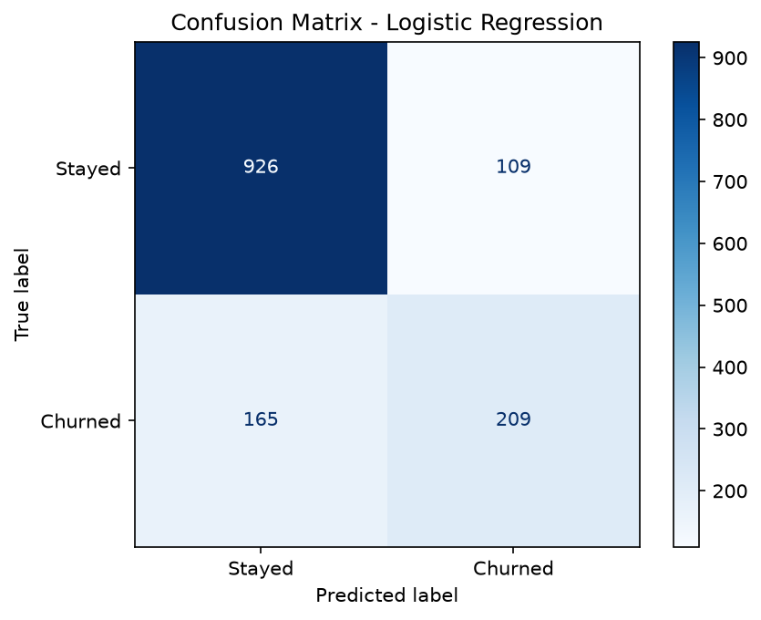
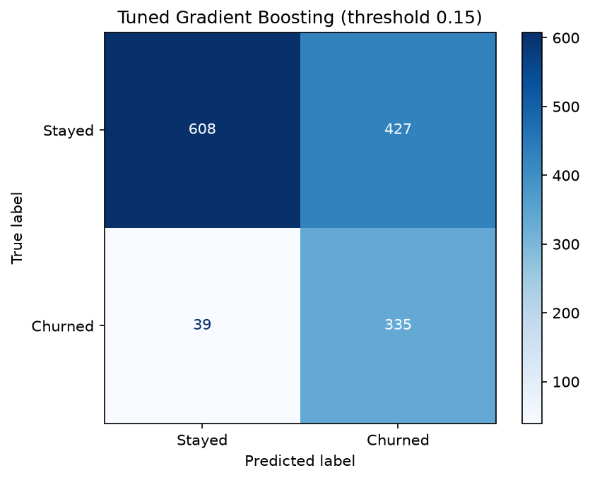
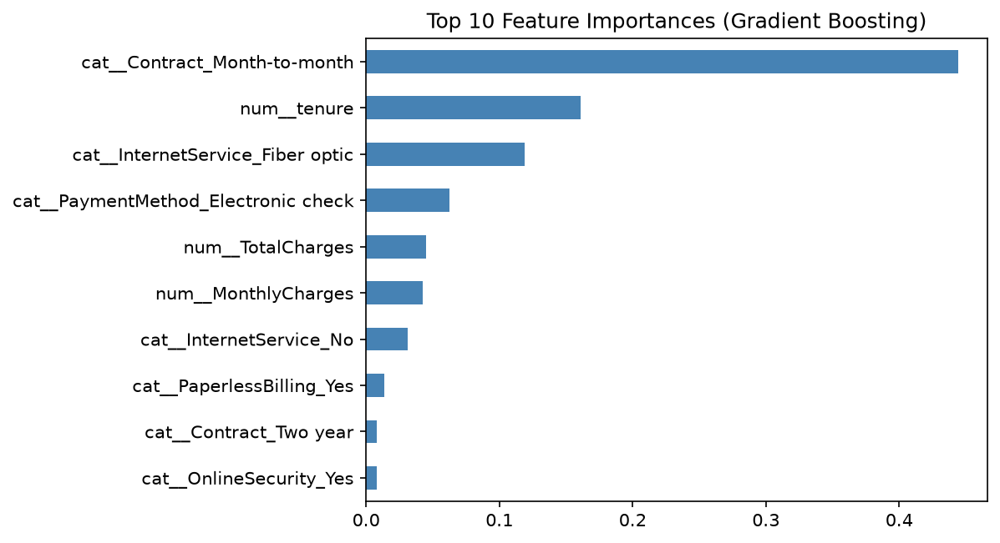

#Customer Churn Prediction
## Results

Baseline logistic regression: ROC-AUC ~0.84, recall 0.56. Using class weighting improved recall to ~0.79.
| Model | Accuracy | Precision | Recall | F1 | ROC-AUC |
|---|---|---|---|---|---|
| Baseline (always "No") | 0.735 | 0.00 | 0.00 | 0.00 | 0.50 |
| Logistic Regression | 0.81 | 0.67 | 0.56 | 0.61 | 0.84 |
| Logistic Regression (balanced) | 0.75 | 0.52 | 0.79 | 0.63 | 0.84 

## Final Model
Tuned Gradient Boosting, ROC-AUC ~0.85 on a held-out test set. Decision threshold chosen for high recall (~0.80) because missing a churner costs more than a wasted retention offer.

