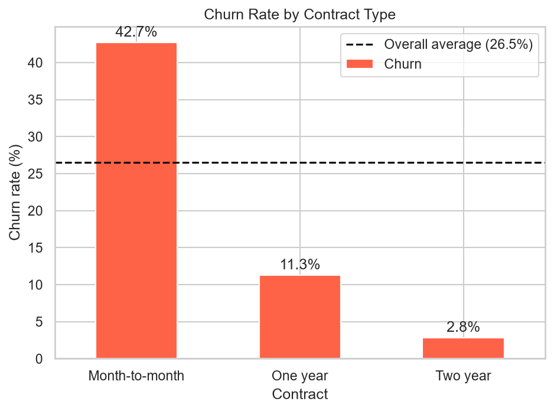
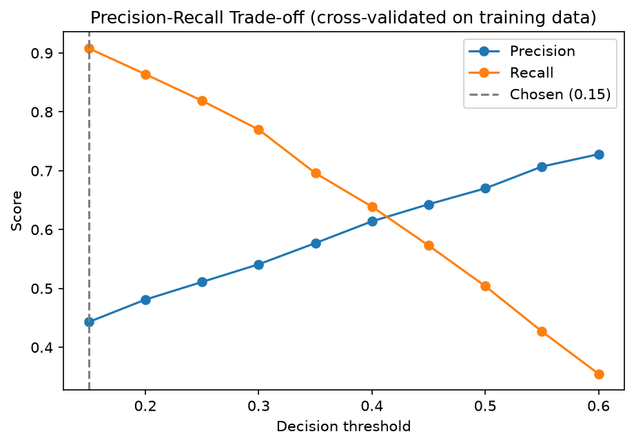

# Customer Churn Prediction

Predicting which telecom customers are likely to leave, so a retention team can act before they do.

**Result:** Tuned Gradient Boosting model with ROC-AUC ≈ 0.85 that catches ≈ 80% of churners on a held-out test set (threshold chosen for recall).


## The Problem
Acquiring a new customer costs far more than keeping an existing one. About 1 in 4 customers in this dataset churns, so the business needs to know **who is at risk and why**. The model scores each customer, and a retention offer can be targeted at the highest-risk ones.

## Dataset
[Telco Customer Churn](https://www.kaggle.com/datasets/blastchar/telco-customer-churn) (public sample dataset): 7,043 customers, 21 columns covering demographics, services, contract, billing, and whether the customer churned.

## Approach
| Step | What I did | Notebook |
|---|---|---|
| 1. Cleaning | Fixed `TotalCharges` stored as text (11 blanks, all new customers), dropped the ID column, merged redundant labels, encoded the target | `01_cleaning.ipynb` |
| 2. EDA | Found the churn drivers with segmented charts | `02_eda.ipynb` |
| 3. Baseline | Logistic regression in a scikit-learn Pipeline (no data leakage) | `03_modeling.ipynb` |
| 4. Model selection | Compared logistic regression, random forest, and gradient boosting with 5-fold stratified CV | `03_modeling.ipynb` |
| 5. Tuning | GridSearchCV on gradient boosting | `03_modeling.ipynb` |
| 6. Threshold | Picked the decision threshold from cross-validated training predictions (F2), then evaluated the test set once | `03_modeling.ipynb` |

## Key Findings


- **Contract type is the strongest driver:** month-to-month customers churn at ~43% vs ~3% for two-year contracts.
- **The first year is the riskiest:** churn falls steadily as tenure grows.
- **Fiber optic and electronic-check customers churn more;** customers with tech support or online security churn about half as often.
- Gender has almost no effect.

*These are associations, not proven causes: features overlap (for example, fiber customers pay more and are more often on month-to-month plans).*

## Model Results
Test set: 1,409 customers.

| Model | CV ROC-AUC | Train ROC-AUC |
|---|---|---|
| Logistic Regression (balanced) | 0.84 | 0.85 |
| Random Forest (balanced) | 0.83 | 1.00 (overfit) |
| Gradient Boosting (tuned) | 0.85 | 0.87 |

**Final model on the test set (threshold 0.30):**

| ROC-AUC | Precision | Recall | F1 |
|---|---|---|---|
| 0.85 | 0.52 | 0.80 | 0.63 |


### Why optimize for recall?
Only 26.5% of customers churn, so a model that predicts "no churn" for everyone is 73.5% accurate and useless. A missed churner costs a customer's lifetime revenue, while a false alarm costs a small discount. So I chose a lower decision threshold to catch more churners, accepting more false alarms. The trade-off is shown below.



## Try It
```bash
git clone https://github.com/Pooja012/customer-churn-prediction.git
cd customer-churn-prediction
python -m venv venv
source venv/Scripts/activate      # Windows Git Bash. Mac/Linux: source venv/bin/activate
pip install -r requirements.txt

python predict.py                                          # high-risk example
python predict.py --file examples/low_risk_customer.json   # low-risk example

